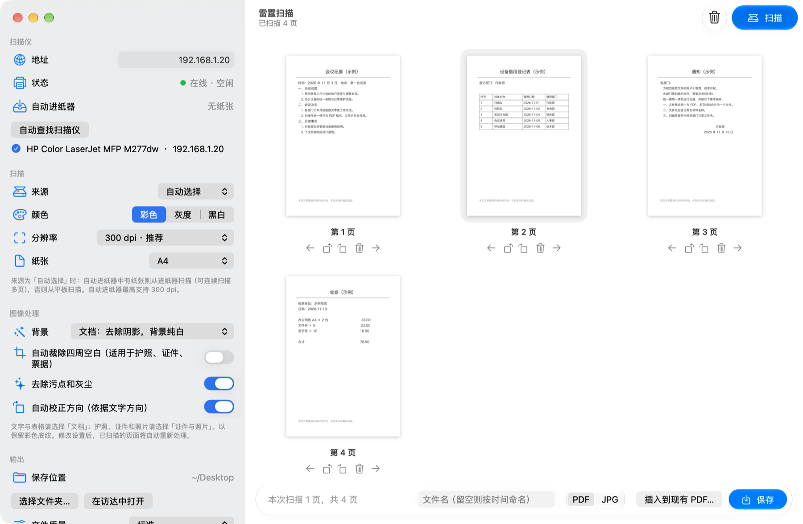

# 雷霆扫描

macOS 网络扫描工具。通过局域网直接连接支持 **eSCL（AirPrint 扫描）** 协议的联网多功能一体机，支持连续扫描多页，并可自动去除阴影、裁除空白、校正方向，最终保存为 PDF 或 JPG。

本软件不依赖打印机厂商驱动，也不依赖 Bonjour 服务发现：在启用代理软件（如 ClashX）导致系统无法发现打印机的情况下，仍可通过网段探测找到扫描仪。

<picture>
  <source media="(prefers-color-scheme: dark)" srcset="docs/screenshot-dark.png">
  
</picture>

<sub>截图中的文档、地址均为演示用示例内容。GitHub 使用暗色主题时显示暗色模式截图。</sub>

## 功能

- **扫描设置**：来源（自动选择 / 平板 / 自动进纸器）、彩色 / 灰度 / 黑白、75–600 dpi、A4 / Letter / 最大扫描区域
- **设备适配**：扫描前读取扫描仪能力，对不支持的分辨率和超出范围的扫描区域自动调整
- **背景处理**
  - 文档：按局部背景亮度归一化，去除阴影，背景纯白，保留表格底纹
  - 证件与照片：仅将接近白色的无彩色像素处理为纯白，保留护照、证件的彩色底纹
  - 不处理：保持扫描原貌
- **自动裁除四周空白**：适用于护照、证件、票据
- **去除污点和灰尘**：去除孤立的小污点，阈值随分辨率换算
- **自动校正方向**：使用系统文字识别（Vision）判断文字方向，自动校正倒置或横置的页面
- **多页管理**：每页可旋转、调整顺序、删除及放大预览
- **输出**：保存为多页 PDF（JPEG 压缩，三档质量）或每页一张 JPG，可指定保存位置
- **插入到现有 PDF**：将扫描页面插入现有 PDF 文件的指定位置，原文件先移至废纸篓备份
- **自动查找扫描仪**：在本机所在网段中探测 eSCL 设备
- **操作确认**：删除页面、保存文件前弹出确认（可在设置中关闭）；保存确认会列出页数、文件名与保存位置
- **外观**：适配浅色与暗色模式；macOS 26 及更高版本采用与访达一致的界面（毛玻璃侧栏、玻璃工具栏、浮动底栏，页面支持右键菜单），较早版本使用不受壁纸染色影响的中性配色

## 系统要求

- macOS 13 Ventura 或更高版本，支持 Intel 与 Apple 芯片（两种架构均已在真机上测试）
- 支持 eSCL（AirPrint 扫描）协议的联网多功能一体机。目前已在 HP Color LaserJet MFP M277dw 上完成测试。

## 下载

前往 [Releases](https://github.com/fatoubed/thunder-scan/releases) 下载最新的 DMG 安装包，打开后将「雷霆扫描」拖入「应用程序」文件夹。

## 首次打开

本软件未经过 Apple 开发者认证，首次打开时会被 Gatekeeper 阻止：

- macOS 13、14：右键点击应用图标，选择「打开」，并在对话框中再次点击「打开」。
- macOS 15 及更高版本：先双击打开一次，然后在「系统设置 → 隐私与安全性」中点击「仍要打开」。

详见 [使用说明.txt](使用说明.txt)。

## 编译

仅需 Xcode 命令行工具（`xcode-select --install`），无需 Xcode 工程。

```bash
bash build.sh      # 编译通用版（x86_64 + arm64），安装到 ~/Desktop/雷霆扫描.app
bash package.sh    # 编译并打包为 build/雷霆扫描-安装包.dmg
```

`build.sh` 可接受一个参数作为安装位置，例如 `bash build.sh /Applications/雷霆扫描.app`。

macOS 27 的命令行工具缺少 SwiftUI 宏插件（`SwiftUIMacros`），使用默认 SDK 无法编译；`build.sh` 会检测到这种情况，自动改用本机较旧的 macOS SDK。也可以用 `SDKROOT=SDK路径 bash build.sh` 手动指定 SDK。

图标由 `make_icon.swift` 生成；删除 `AppIcon.icns` 后重新运行 `build.sh` 即可重新生成。

## 命令行（调试用）

```bash
Scanner --discover                                   # 查找局域网中的扫描仪
Scanner --scan out.pdf [host=IP] [dpi=300] [bg=document|light|off] [color=color|gray|bw] [crop=1] [rot=auto]
Scanner --process in.pdf|in.jpg out.pdf [同上处理选项]
```

`Scanner` 位于 `雷霆扫描.app/Contents/MacOS/` 目录下。

调试用环境变量：

| 变量 | 作用 |
| --- | --- |
| `SCAN_DEMO=1` | 演示模式：显示示例地址，不连接真实设备 |
| `SCAN_TEST_IMAGES=图1,图2` | 启动后预先载入页面 |
| `SCAN_SNAPSHOT=输出.png` | 启动后截取窗口并退出；可配合 `SCAN_SNAPSHOT_SIZE=宽x高`、`SCAN_SNAPSHOT_DELAY=秒` |
| `SCAN_TEST_ACTION=save` / `delete` | 截图前触发保存确认或删除确认，确认框另存为 `*_sheet.png` |
| `SCAN_APPEARANCE=light` / `dark` | 强制浅色或暗色外观 |
| `SCAN_STYLE=glass` / `plain` | 强制使用毛玻璃（macOS 26 及以上为访达式界面）或中性配色 |

## 文件

| 文件 | 说明 |
| --- | --- |
| `ScanApp.swift` | 全部源码（SwiftUI 界面、eSCL 协议、图像处理、导出） |
| `build.sh` | 编译、生成 Info.plist、ad-hoc 签名、安装 |
| `package.sh` | 打包 DMG |
| `make_icon.swift` | 生成图标 |
| `使用说明.txt` | 面向最终用户的中文说明（随 DMG 分发） |
| `docs/screenshot.png`、`docs/screenshot-dark.png` | README 截图（浅色、暗色） |

## 开源协议

[MIT](LICENSE)
